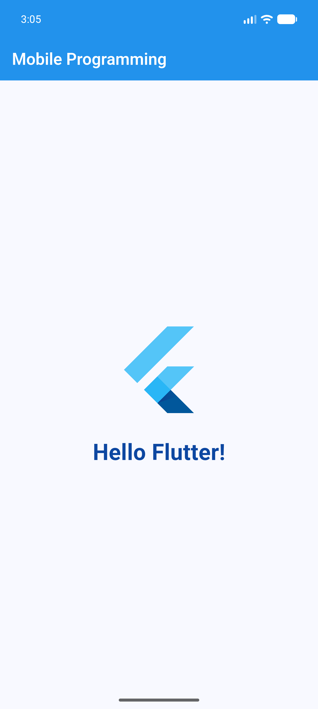
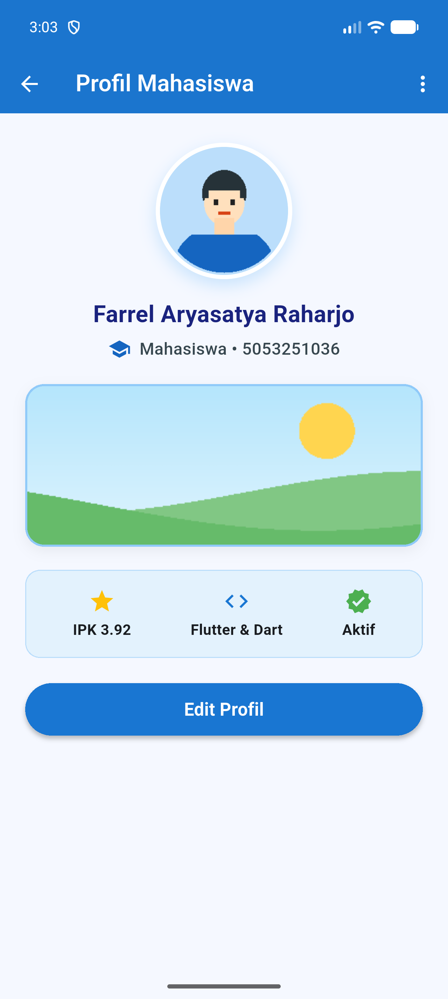
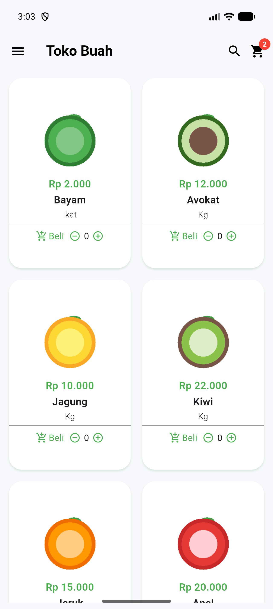

# Tugas 12 Pemrograman Perangkat Bergerak (PBB M) — Flutter Mobile Development

- **Nama:** Farrel Aryasatya Raharjo
- **NRP:** 5053251036
- **Kelas:** PBB M
- **Tahun:** 2026

## Daftar Proyek Flutter (Pertemuan 12)

1. **`hello_flutter`** — Praktikum Pemula: Membuat Aplikasi Flutter Pertama (*Hello Flutter!*)
2. **`student_profile`** — Studi Kasus Struktur Folder & Mengenal Widget di Flutter (*Profil Mahasiswa*)
3. **`flutter_fruit_app`** — Studi Kasus Aplikasi Katalog GridView (*Toko Buah*)

## Tangkapan Layar (Android Emulator)

| Hello Flutter | Student Profile | Toko Buah (Flutter Fruit App) |
| :---: | :---: | :---: |
|  |  |  |
